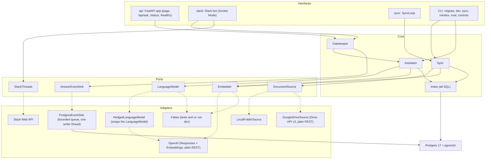
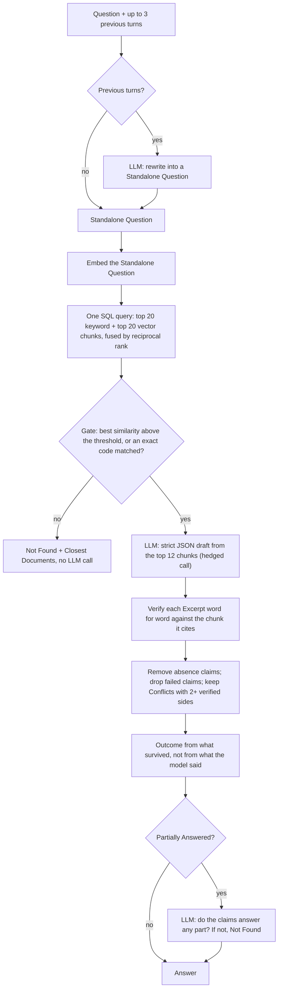
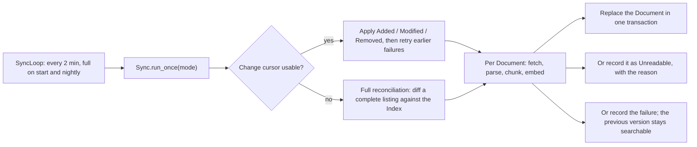
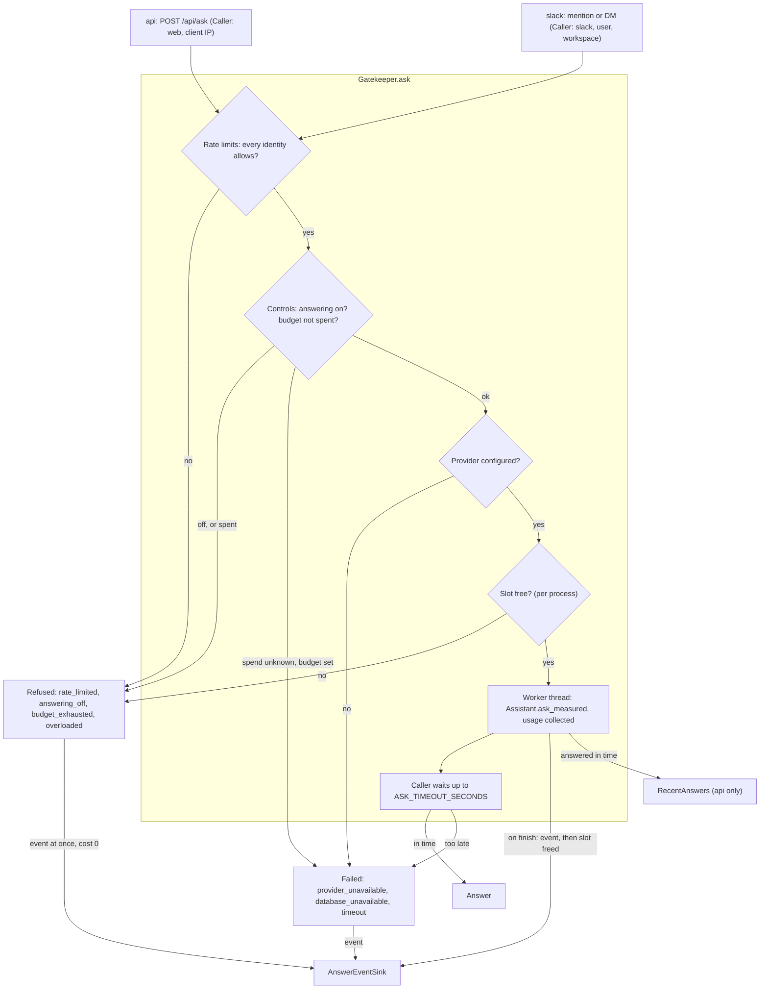

# Architecture

How Grounded Docs is put together, and why. The README covers what it does and how it was measured; [CODE_SAMPLES.md](CODE_SAMPLES.md) shows some of the code.

## Vocabulary

| Term | Meaning |
| --- | --- |
| **Document** | One file in the Document Source (a PDF, a Word file, a Google Doc). |
| **Document Source** | Where Documents live: a local folder or a Google Drive folder. |
| **Sync** | The process that keeps the Index in step with the Document Source. |
| **Index** | The Postgres database: Documents, their chunks, vectors, keyword indexes and Sync state. |
| **Question / Standalone Question** | What the person asked; a Follow-up is rewritten into a Standalone Question before it is searched. |
| **Answer** | The verified result of a Question: an Outcome, claims with Citations, Conflicts, what is missing. |
| **Outcome** | *Answered*, *Partially Answered* or *Not Found*. |
| **Citation / Excerpt** | Where a claim comes from (Document, Location, link) and the verbatim text that supports it. |
| **Location** | A page (PDF) or a heading path (Word, Google Docs) inside a Document. |
| **Conflict** | Two current, independent Documents that disagree; both sides are shown and cited. |
| **Unreadable** | A Document Sync cannot read: password-protected, scanned, too large or an unsupported type. |
| **Session** | The previous turns of a conversation. It lives in the browser tab or the Slack thread, never on the server. |
| **Gatekeeper** | The one door every Question passes, from the web and from Slack: rate limits, operator controls, the provider check, the concurrency cap, then the Assistant under the overall timeout. |
| **Refusal** | A Question the Gatekeeper turned away before any model call, with its reason (`rate_limited`, `overloaded`, `budget_exhausted`, `answering_off`) and a short message for the person. A failure (`timeout`, `provider_unavailable`, `database_unavailable`) is not a refusal. |
| **Answer event** | One row per request, answered, refused or failed: counts, timings, tokens, cost and versions, never any Question or Answer text. |
| **Operator controls** | Values the operator changes live with the `controls` command: the kill switch (answering on or off, with a message), the daily budget (a spending limit reset at 00:00 UTC) and the rate limits. `.env` holds their defaults. |
| **Vote / Review text** | A 👍 or 👎 on an Answer; with the opt-in setting, a 👎 also keeps that Answer's text for 30 days for a reviewer. |

## Modules and ports

The core is three deep modules with small interfaces: `Assistant.ask(question, previous_turns) -> Answer`, `Sync.run_once(mode) -> SyncReport` and `Gatekeeper.ask(question, previous_turns, caller) -> Answer | Refused | Failed`, which both interfaces call instead of the Assistant. Each external system sits behind a port (a `typing.Protocol` in `ports.py`); the core never imports an adapter, so tests swap in fakes and providers change by configuration.

| Module | Responsibility |
| --- | --- |
| `assistant.py` | The answer pipeline: rewrite, search, gate, draft, verify, decide the Outcome. Callers never see chunks, scores or prompts. |
| `sync.py`, `sync_loop.py` | One Sync cycle (incremental or full), and the schedule that runs cycles. |
| `index.py` | Every SQL statement: hybrid search, Document replacement, Sync state, status counts. |
| `parsing.py`, `chunking.py` | PDF and DOCX to Located sections, or a reason the file is Unreadable; sections to chunks of about 600 tokens. |
| `contracts.py` | Pydantic models for everything that crosses a boundary: the Answer, the model's draft, the API request, Sync reports, status. |
| `ports.py` | The ports, and the one failure every provider adapter raises: `ProviderUnavailable`. |
| `adapters/`, `sources/` | OpenAI, Google Drive and local-folder adapters; fakes. |
| `hedging.py` | A LanguageModel wrapper that cuts tail latency on the answer call. |
| `usage.py` | Usage per request: every billed provider call made for one Question, collected for it (a hedge's and an abandoned call's included) and priced. |
| `pricing.py` | The price table and `cost_usd`, shared by the running service (as billed) and the evaluation (cold). |
| `gatekeeper.py` | Every Question's path: rate limits, controls, the slot, the worker, the timeout, the event. Returns an Answer, a `Refused` or a `Failed`; the interfaces only map that to their output. |
| `events.py` | Answer events: the builders (from an Answer and its diagnostics, a refusal or a failure) and `PostgresEventSink`, which writes them off the request's path. |
| `controls.py`, `controls_command.py` | The operator controls: the registry and its validation, `OperatorControls` (cached reads with today's spend), the Postgres store, and the `controls` command. |
| `rate_limits.py`, `refusals.py` | Token buckets with a daily count, per identity, in memory; the refusal wording and HTTP status shared by the web and Slack. |
| `feedback.py`, `recent_answers.py` | Votes (`Feedback` over a `VoteStore` port and its Postgres adapter), and the API's memory of the last hour's Answers, with their text only when review text is on. |
| `retention.py` | The nightly purge of review text, old answer events and their votes. |
| `status.py` | The status report, its Protection part included (`ProtectionReport`). |
| `clock.py` | The injectable clock, and midnight UTC for the budget and the daily limits. |
| `loadtest.py` | The load test's fake providers, replaying recorded call times (never used by a running deployment). |
| `providers.py`, `settings.py` | Wiring: settings from the environment, adapters from settings. The only place that picks an adapter. |
| `api/`, `slack_bot/` | Thin interfaces over the Assistant and the status queries. |
| `evaluation/` | The `eval` harness: retrieval, answer and Sync measurements over the demo corpus. |
| `migrations/` | Numbered SQL files and the `migrate` command. |

## The answer pipeline

`Assistant.ask` enforces grounding in code, in three layers: a relevance gate, a strict structured draft, and word-for-word Excerpt verification.

**Why drop rather than retry:** retrying with feedback on a failed check roughly doubles response time on exactly the hardest Questions, and rejecting the whole Answer throws away claims that did verify. Dropping a failed claim and downgrading the Outcome keeps both speed and the verified part.

- **Search** is hybrid: Postgres full-text (English stems, plain words, and one whole lexeme per code such as `LQA-MSA-2025-014`, so a code does not match its siblings) and pgvector cosine distance over an HNSW index, fused by reciprocal rank in a single query. Chunks are embedded and keyword-indexed together with their Document title and Location.
- **The gate** stops a Question before any model call when nothing retrieved is close enough. The threshold was tuned for `text-embedding-3-small` on the dev split of the evaluation set and is retuned with `eval screen` for another embedding model.
- **The draft** is a strict structured output: an Outcome, claims each carrying a Citation (a chunk number and an Excerpt), Conflicts and missing parts. Free prose is never accepted.
- **Verification** compares each Excerpt, after normalisation (Unicode NFKC, typographic quotes and dashes, whitespace), against the text of the chunk it cites. A claim that fails is dropped and the Answer says some evidence could not be verified. A claim that only says the Documents are silent is removed: the model sees a few chunks, not the Documents, so such a claim cannot be verified. When versions of one document disagree (v3 and v4, DRAFT and FINAL), the latest one answers: FINAL over DRAFT, then the later effective date, then the higher version number. File modification times are not used, because they reflect copying, not which version is in force. Independent current Documents that disagree are shown as a Conflict, both sides cited.
- **No streaming.** Text reaches the person only after it has been verified.

Follow-ups need no server-side history: the browser keeps the Session in `sessionStorage`, the Slack bot reads it back from the thread, and the Assistant uses the latest 3 turns.

## Sync

Sync keeps the Index in step with the Document Source by polling.

**Why polling:** Drive push notifications need a publicly reachable HTTPS webhook, and the assistant is meant to run privately with nothing exposed. Polling every 2 minutes plus a nightly full reconciliation keeps it private; a new Document is findable within about 2 minutes plus indexing time.

**Why a Document Source port:** a public demo cannot ship Drive credentials, so `docker compose up` runs on a local folder with no credentials, while the Drive adapter is fully implemented and tested against a fake Drive. Both report changes in the same terms, so indexing never sees a Drive quirk.

- **One vocabulary for changes.** Both adapters report Added, Modified and Removed. Drive's quirks (trash, permanent deletion, unsharing, moves into and out of the folder, folders entering the tree, Google Docs exported as DOCX) are translated inside `GoogleDriveSource`; the local folder has no change feed, so every cycle there is a reconciliation by content hash.
- **Atomic replacement.** A Modified Document's old row and chunks are deleted and the new ones inserted in one transaction, so a Question never sees it half-indexed or twice.
- **Failure isolation.** A Document whose fetch, parse or embedding fails is recorded in `sync_failures`, keeps its previous version and is retried every cycle; the change cursor moves on without it. A listing that fails (a missing or unshared folder) fails the cycle rather than removing everything.
- **Embedding model guard.** Vectors from two embedding models are not comparable. Every Document records the model that embedded it; `api` refuses to start and `sync` pauses when the Index holds another model, until `reindex` rebuilds it.

## Protection and measurement

The Assistant answers well, but on its own it runs unguarded: a script or a burst of people can run up a bill nobody sees coming, and a timed-out Question's model call is abandoned, not killed, so it keeps running and costing. Every Question therefore passes one Gatekeeper, and every request leaves one answer event behind.

### The Gatekeeper

- **Order.** Rate limits come first, so every Question counts toward its limit, even one a later check refuses. Then the operator controls, then the provider check, then the slot. A refusal makes no model call.
- **The slot is held until the worker really ends.** The worker is a daemon thread (a thread cannot be killed). After a 504 it carries on, keeps its slot and writes its event when it finishes, marked `timed_out`, with the late calls' cost. So the cap counts the model calls still running and costing, not the requests still waiting. A shared flag decides the race between the caller's timeout and the worker's finish, so a 504 always has `timed_out` on its event and an Answer never does.
- **The worker's order** is: build and record the event, register the Answer with `RecentAnswers` (`on_answered(AnsweredQuestion)`, `api` only, skipped after a 504, whose client never got the id), resolve the caller, free the slot. A vote can therefore never arrive before its Answer is known. A failure to build or record the event, or to register, is logged by type and never fails the Answer.
- **Per-request usage.** The worker starts in a copy of the caller's `contextvars` context and opens its own `UsageCollector`. Every billed provider call made for that Question lands there, including a hedge's (`hedging.ThreadRunner` copies the context into its threads too) and an abandoned one's, priced as billed with the evaluation's price table (`pricing.py`). An unpriced model costs NULL, with one warning per process. `hedged` / `hedge_won` come from the hedge decorator through a context variable of their own (`hedging.observing_hedge`).
- **Why a counter, not a queue.** Beyond the cap, a Question is refused at once (`overloaded`) instead of waiting: under a burst, a queue only turns into timeouts that still cost. Slots are a counter under a lock rather than a semaphore, so `in_flight` is readable for `/status`.
- **The cap's value.** `API_MAX_IN_FLIGHT` stays below anyio's 40 worker threads (at most 32). Its default, 16, comes from the load test (below). Each process's Index pool is `max_in_flight + 2`: the 2 spare connections serve the status queries, so the cap, not the pool's 5 s wait, refuses a burst. The event writer, the controls, the votes and the purge each have a connection of their own.

The interfaces only map the result: `api` to a status and an `ErrorResponse` (`{"error", "message"}`, `Retry-After` where the reason has one), Slack to an edit of "Searching…". The wording lives in one table, `refusals.py`, and the page inserts it with `textContent`, never as HTML.

### Answer events

`AnswerEventSink.record(event)` never raises. `PostgresEventSink` puts the event on a bounded queue (`EVENT_QUEUE_SIZE`) and returns; one writer thread inserts it over its own connection (2 s connect and statement timeouts; a connection that died while idle is retried once). A full queue drops the event with a warning and a running count; a failed insert is logged by exception type only, since a database error can quote the row. On SIGTERM `serve` closes the sink, which drains for up to 2 s.

The `request_id` is the id in the logs and the Answer's `answer_id`, so a 👎 or an alert leads to its log lines. The table has no free-text column: a schema test fails if one appears beyond the enumerated identifiers and version strings, and `CHECK` constraints hold every enumerated column. A gated Question, and a failure where both answer calls failed, record `hedged` as NULL. The load test's events are marked `synthetic` (`Versions.synthetic`, passed once to the Gatekeeper with the fake models' names).

### Operator controls

`operator_controls` holds one row per control changed with `controls`; a missing row means the `.env` default (key/value rows, so a new control needs no migration). `OperatorControls.current()` reads every value with its source and today's spend (the sum of `cost_usd` since 00:00 UTC, NULLs ignored) in one query on its own connection, cached for 5 s. Past the cache window one caller reads while the others keep the cached values, so a slow database holds at most one Question. On a failed read the last good values hold for 60 s; after that the `.env` defaults apply with the spend unknown, and with a budget set Questions fail closed (`database_unavailable`): with the spend unknown, nothing proves the budget allows them. With no budget set, answering continues.

`controls` validates a value before saving it, writes the row and an `operator_control_changes` row in one transaction (`SELECT … FOR UPDATE`, a change row only when the value differs), and logs `operator control changed` as a warning. With a budget set, an unpriced configured model pauses `api` and `slack` at start, naming it, and `controls` refuses to set a budget.

### Rate limits

`RateLimiter.check(identities, limits)`: a token bucket per identity (a burst of the per-minute limit passes, then one more every 60/N s) and a daily count reset at 00:00 UTC. Every identity must allow; a Question one of them refuses spends none of them. The limits are live controls read from the same cached snapshot; 0 turns one off, a lowered limit clamps at once, a raised one refills at its rate. Idle identities are swept at most once a minute. The counts live in memory, per process: there is one `api` and one `slack` process, and a restart resets them.

- Web: the client IP. `TRUSTED_PROXY_IPS` (IPs or networks) is passed to uvicorn's `forwarded_allow_ips`; empty, `proxy_headers` is off, so a forged `X-Forwarded-For` changes nothing, even from 127.0.0.1.
- Slack: the user (`event["user"]`; a DM and a channel share it) and the workspace that installed the bot (bolt's `context.team_id`, which in a Slack Connect channel is the installation, not the asker's own team). An event without a user is limited by its workspace alone.
- Votes: `Feedback` has its own limiter per client IP (`feedback_per_minute`).

Identities are never recorded or logged.

### Feedback and review text

`POST /api/feedback` goes through `Feedback.vote`: validation, the vote limit, then whether the Answer is known, either in `RecentAnswers` (the latest 1,000 Answers this API gave in the last hour, in memory) or with an `answered`, not timed-out row in `answer_events`. An unknown id is a 404, so an id probe still spends the limit. `answer_votes` is append-only; the latest row is the current vote, and a vote equal to it inserts nothing. "Read the latest, insert if different" runs under a per-Answer advisory lock, so concurrent votes store one row. Votes use one connection of their own; any database error drops it and answers 503.

Review text is opt-in (`REVIEW_TEXT_ON_DOWNVOTE`, off by default): it is the one place the server stores what people asked. `RecentAnswers(keep_text=…)` keeps the id always and the `AnsweredQuestion` (the Question as typed and the Answer) only when it is on, and only for an hour from the Answer. A new 👎 vote row with text in memory upserts `review_texts` (Question as typed, Standalone Question, the Answer's JSON as shown) in the vote's own transaction; any 👍 deletes it. The earlier turns never reach the hook, so they cannot be stored.

### Retention

`SyncLoop(purge=…)` runs `PostgresRetention.purge(now)` after the first cycle after start, then after the first cycle at or after `FULL_SYNC_HOUR` each night, whatever the cycle did. One transaction on a connection of its own (60 s statement timeout) deletes review text older than 30 days (from the 👎), answer events older than `EVENT_RETENTION_DAYS` with their votes and review text, and votes past the retention whose event was never written, by their own time. A failed purge is logged by type and tried the next night; it never fails a cycle. A restart purges again, which is idempotent. Only the `sync` service's loop purges: while it is paused (no provider key), or when Sync runs as `sync --once` / `--full` from cron, nothing is purged.

### `/status` Protection section

`ProtectionReport` assembles answering on or off (and the message), today's spend against the budget and its source, today's refusals by reason, and this API's in-flight count against its cap (the Slack bot's slots are in another process, so the page says "API only"). The controls come from the Gatekeeper's own cache; the refusal counts are one `GROUP BY` per status request. A spend or count that cannot be read is `null`, shown as unknown. Answering off, a spent budget, or an unknown spend makes the page say "Needs attention". `/healthz` ignores all of it: a switched-off service is still alive.

### Load test

`loadtest/ask.js` (k6, image pinned by digest) asks the dev split's Questions (`loadtest/questions.json`, generated from `eval/questions.toml`) in steps of 1, 2, 4, 8, 16 and 32 at once, 60 s each, and polls `/api/status` every 2 s. `docker-compose.loadtest.yml` runs it under its own project, database volume and image tag, never reading `.env`. Its `api` runs `python -m grounded_docs.loadtest serve --recording …`, the only way to start the fakes: the answer call sleeps a duration drawn (seeded) from the recorded call times in `tests/fixtures/hedge_timings.json`, each replayed as answered at the shipped hedge delay (`HedgeRecording`, `ReplayedLatency`, `SlowLanguageModel`); embedding sleeps 300 ms and a rewrite 1.5 s (`SlowEmbedder`); the cap is 32 so steps over 8 measure answers rather than 503s, the rate limits are off and there is no budget. `loadtest_app` reuses `dev.synced_app`, the same sync-then-serve body as `uv run dev`. The Questions are typed `LoadtestQuestion`s (id, Question, previous turns), and a test keeps the committed file equal to the evaluation set's dev split. Each step's p95 is reported against 8 s in the summary's own column; the script always exits 0.

On v1.1.0 (12 threads, 15 GB), no step's p95 passed 8 s (4.48 s at 1, 5.15 s at 16, 4.83 s at 32), so the stack's own work is not the limit up to 32, and the default is N = 16: one step below the first p95 over 8 s, and with none over it, 32 minus one step. A separate check with the cap lowered to 2 refused 48 of 50 Questions `overloaded` at once, each with its event. A fake Answer has one claim where real ones have several, so verification work per Question is somewhat lower than in production.

## Storage

One Postgres database holds the whole Index.

**Why one Postgres:** hybrid search needs vectors and keyword matching together, and Sync must swap a Document without it ever being half-indexed or present twice. With vectors, full-text indexes and Sync state in one database, each swap is one transaction and hybrid search is one query. A separate vector database would add a service and lose that single transaction. The trade-off: Postgres keyword ranking is weaker than true BM25, which the evaluation's exact-ID questions check.

| Table | Holds |
| --- | --- |
| `documents` | One row per indexed Document: source id, title, version, link, embedding model. |
| `chunks` | Text, Location, a generated `tsvector` (with whole-code lexemes) under a GIN index, and a `vector(1536)` under an HNSW index. |
| `unreadable_documents` | Documents that could not be read, the reason and the version seen. |
| `sync_failures` | Documents whose last attempt failed, with the entry to retry from. |
| `sync_state` | The Source's change cursor and the last successful incremental and full Sync times. |
| `answer_events` | One row per request (migration 0006): status, reason, Outcome, counts, stage timings, tokens, cost, versions, `synthetic`, the Slack workspace id. No Question or Answer text. |
| `operator_controls`, `operator_control_changes` | The controls changed with `controls`, and every change (0007). |
| `answer_votes` | Votes, append-only (0008). |
| `review_texts` | Review text for 👎 Answers, opt-in, deleted after 30 days (0009). |
| `schema_migrations` | Applied migrations. |

Migrations are numbered SQL files, each applied in its own transaction under an advisory lock, so `api` and `sync` can start together. Every connection sets a statement timeout. No Question or Answer text is stored unless review text is turned on, and then only for 👎 Answers: the server keeps no conversation, and logs carry text only when `LOG_QUESTIONS=true`.

## Deployment

One image runs four Docker Compose services: `api` (web page, HTTP API, status page), `sync` (the Sync loop), `slack` (the Slack bot, over Socket Mode, so nothing is exposed to the internet) and `postgres`. Services run as a non-root user. A service that cannot work (no API key, no Slack tokens, an embedding model mismatch) stays up and paused, logging why, instead of restart-looping; `api` never waits for `sync` or `slack`.

## Failure modes

The rule throughout: **never a fallback Answer.** A failure is reported as a failure, never dressed up as an Answer.

| Failure | Behaviour |
| --- | --- |
| OpenAI slow or failing | Each call times out after 10 s; 408, 409, 429 and 5xx, timeouts and connection errors are retried up to 3 times with exponential backoff and full jitter. Quota errors and other 4xx are not retried. After that the adapter raises `ProviderUnavailable`, and `/api/ask` answers 503. |
| Malformed structured output | Requested once more, then treated as a provider failure. |
| Slow answer call (tail latency) | If the answer call has not returned after 5 s, one identical hedge call starts; the first success wins. At most two calls in flight. |
| Partial-answer check unavailable | Fail-open: the partial Answer stands, because its claims are already verified. |
| Question takes too long overall | `/api/ask` answers 504 after 25 s; the Slack bot shows the unavailable message. The worker keeps its slot until its calls end, then writes its event, `timed_out`, with the full cost. |
| Burst over the cap | `503 overloaded` at once, no model call, an event written. |
| Over a rate limit | `429 rate_limited` with `Retry-After` (Slack: the same message), no model call, an event written. |
| Answering off, or the daily budget spent | `503 answering_off` with the operator's message, or `503 budget_exhausted` with `Retry-After` to 00:00 UTC; no model call; `/healthz` stays green. |
| Spend passes the budget mid-flight | Questions in flight finish; the overshoot is at most one Question's cost per Question in flight. |
| Controls unreadable | The last good values for 60 s; then the `.env` defaults (the kill switch back to "on"), and with a budget set, `503 database_unavailable` (fail closed on spending). |
| Unpriced model | With a budget: `api` and `slack` pause at start, naming the model. Without: cost NULL on the event, one warning. |
| Event insert fails, or the queue is full | Logged (type only) or dropped with a running count; the Answer is unaffected. |
| Votes' database unreachable | `/api/feedback` answers 503 `database_unavailable`; asking is unaffected. |
| Process restart | Rate-limit counts, `RecentAnswers` and slots reset; votes on older Answers still work through their events, but their text can no longer be kept. |
| Forged `X-Forwarded-For` | Ignored unless the peer is in `TRUSTED_PROXY_IPS`. |
| Purge fails | Logged by type; tried the next night; Sync unaffected. |
| Database unreachable or stuck | Pool and connect timeouts of 5 s, a 5 s statement timeout; `/api/ask` and `/api/status` answer 503 `database_unavailable`, `/healthz` reports it. |
| No API key configured | The stack starts; `/api/ask` answers 503 (a `failed` event); `sync` and `slack` pause (so nothing is purged); the status page says why. |
| A Document fails to sync | Its previous version stays searchable; listed on the status page with the error; retried every cycle. |
| A Document cannot be read | Listed as Unreadable with its reason; named in Answers it might have answered. |
| Sync cycle fails | Logged; the next cycle runs on schedule; a failed full reconciliation is retried an hour later. |

Provider adapters log operations, statuses, attempts and token counts: never prompts, Document text, model output or provider error messages, which can quote the API key.

## Where the tests sit

| Layer | Location | What it covers |
| --- | --- | --- |
| Unit | `tests/unit/` | Parsing, chunking, contracts, settings, prompts, hedging (on a scripted timeline), the Slack bot (fake Slack), the status API, the Sync loop (fake clock), evaluation scoring. Adapter contract tests run against recorded OpenAI responses and a fake Drive. Protection, with fakes and a fake clock: the Gatekeeper (`test_gatekeeper.py`: each refusal with its event and no model call, a slow fake holding every slot, the 504 that keeps its slot, two concurrent requests' usage), usage per request (`test_usage.py`), event builders and the queued sink (`test_answer_event_builder.py`, `test_answer_events.py`), the controls' cache and fallback (`test_operator_controls.py`), rate limits (`test_rate_limits.py`), trusted proxies through uvicorn's own config (`test_api_serve.py`), refusals through the API and Slack (`test_ask_failures.py`, `test_slack_bot.py`), votes (`test_feedback.py`, `test_feedback_api.py`, `test_recent_answers.py`), the Protection section (`test_status_api.py`, `test_protection_status.py`), and the load test's fakes and Questions (`test_loadtest_latency.py`, `test_loadtest_questions.py`). |
| Integration | `tests/integration/` | The Assistant and Sync end to end against a real Postgres with pgvector (a testcontainers container locally, a service container in CI), with fake providers: grounding and downgrades, hybrid search, follow-ups, Sync changes and failures, migrations, query timeouts, the HTTP API. Protection on real Postgres: events read back field by field with the no-text schema test and `CHECK`s (`test_answer_events.py`), one event per Answer from both interfaces under the logged id (`test_gatekeeper_events.py`), the `controls` command and both Gatekeepers seeing a change (`test_operator_controls.py`), votes (`test_feedback.py`), review text (`test_review_texts.py`), the purge (`test_retention.py`), refusal counts (`test_status.py`), and the load-test app (`test_loadtest.py`). |
| Live | `tests/live/` | A few calls to the real OpenAI API; skipped unless a key is set, never run in CI. |
| Evaluation | `uv run eval` | Not a test: 99 questions over the demo corpus with the real providers, split into dev (for tuning) and held-out (for reporting). Results are in the README. |
| Load test | `loadtest/ask.js` | Not in CI: a script and a documented run over fake providers (above). |

CI runs two jobs on every push: lint, format check, strict mypy and the full test suite against a Postgres service; and a Compose smoke test that builds the image, starts the stack from a clean checkout with no provider keys, and checks `/healthz`, `/api/status` and that every service stays running.
