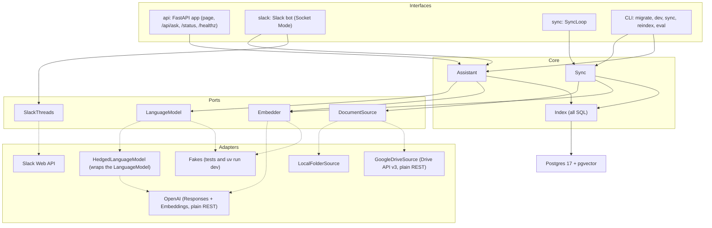
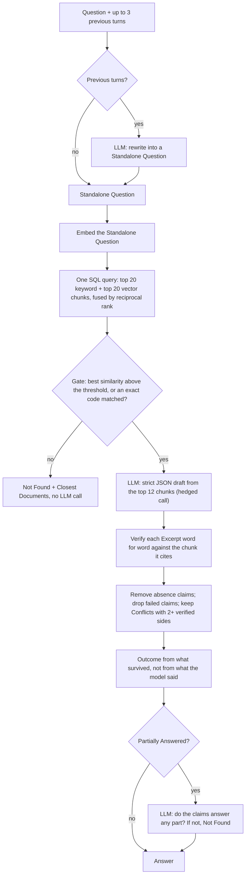
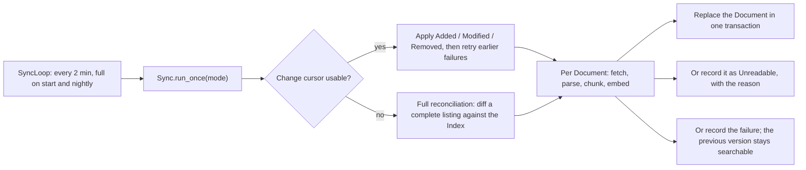

# Architecture

How Grounded Docs is put together, and why. The README covers what it does and how it was measured; [CODE_SAMPLES.md](CODE_SAMPLES.md) shows some of the code.

## Vocabulary

| Term | Meaning |
| --- | --- |
| **Document** | One file in the Document Source (a PDF, a Word file, a Google Doc). |
| **Document Source** | Where Documents live: a local folder or a Google Drive folder. |
| **Sync** | The process that keeps the Index in step with the Document Source. |
| **Index** | The Postgres database: Documents, their chunks, vectors, keyword indexes and Sync state. |
| **Question / Standalone Question** | What the person asked; a Follow-up is rewritten into a Standalone Question before it is searched. |
| **Answer** | The verified result of a Question: an Outcome, claims with Citations, Conflicts, what is missing. |
| **Outcome** | *Answered*, *Partially Answered* or *Not Found*. |
| **Citation / Excerpt** | Where a claim comes from (Document, Location, link) and the verbatim text that supports it. |
| **Location** | A page (PDF) or a heading path (Word, Google Docs) inside a Document. |
| **Conflict** | Two current, independent Documents that disagree; both sides are shown and cited. |
| **Unreadable** | A Document Sync cannot read: password-protected, scanned, too large or an unsupported type. |
| **Session** | The previous turns of a conversation. It lives in the browser tab or the Slack thread, never on the server. |

## Modules and ports

The core is two deep modules with small interfaces: `Assistant.ask(question, previous_turns) -> Answer` and `Sync.run_once(mode) -> SyncReport`. Each external system sits behind a port (a `typing.Protocol` in `ports.py`); the core never imports an adapter, so tests swap in fakes and providers change by configuration.

| Module | Responsibility |
| --- | --- |
| `assistant.py` | The answer pipeline: rewrite, search, gate, draft, verify, decide the Outcome. Callers never see chunks, scores or prompts. |
| `sync.py`, `sync_loop.py` | One Sync cycle (incremental or full), and the schedule that runs cycles. |
| `index.py` | Every SQL statement: hybrid search, Document replacement, Sync state, status counts. |
| `parsing.py`, `chunking.py` | PDF and DOCX to Located sections, or a reason the file is Unreadable; sections to chunks of about 600 tokens. |
| `contracts.py` | Pydantic models for everything that crosses a boundary: the Answer, the model's draft, the API request, Sync reports, status. |
| `ports.py` | The ports, and the one failure every provider adapter raises: `ProviderUnavailable`. |
| `adapters/`, `sources/` | OpenAI, Google Drive and local-folder adapters; fakes. |
| `hedging.py` | A LanguageModel wrapper that cuts tail latency on the answer call. |
| `providers.py`, `settings.py` | Wiring: settings from the environment, adapters from settings. The only place that picks an adapter. |
| `api/`, `slack_bot/` | Thin interfaces over the Assistant and the status queries. |
| `evaluation/` | The `eval` harness: retrieval, answer and Sync measurements over the demo corpus. |
| `migrations/` | Numbered SQL files and the `migrate` command. |

## The answer pipeline

`Assistant.ask` enforces grounding in code, in three layers: a relevance gate, a strict structured draft, and word-for-word Excerpt verification.

**Why drop rather than retry:** retrying with feedback on a failed check roughly doubles response time on exactly the hardest Questions, and rejecting the whole Answer throws away claims that did verify. Dropping a failed claim and downgrading the Outcome keeps both speed and the verified part.

- **Search** is hybrid: Postgres full-text (English stems, plain words, and one whole lexeme per code such as `LQA-MSA-2025-014`, so a code does not match its siblings) and pgvector cosine distance over an HNSW index, fused by reciprocal rank in a single query. Chunks are embedded and keyword-indexed together with their Document title and Location.
- **The gate** stops a Question before any model call when nothing retrieved is close enough. The threshold was tuned for `text-embedding-3-small` on the dev split of the evaluation set and is retuned with `eval screen` for another embedding model.
- **The draft** is a strict structured output: an Outcome, claims each carrying a Citation (a chunk number and an Excerpt), Conflicts and missing parts. Free prose is never accepted.
- **Verification** compares each Excerpt, after normalisation (Unicode NFKC, typographic quotes and dashes, whitespace), against the text of the chunk it cites. A claim that fails is dropped and the Answer says some evidence could not be verified. A claim that only says the Documents are silent is removed: the model sees a few chunks, not the Documents, so such a claim cannot be verified. When versions of one document disagree (v3 and v4, DRAFT and FINAL), the latest one answers: FINAL over DRAFT, then the later effective date, then the higher version number. File modification times are not used, because they reflect copying, not which version is in force. Independent current Documents that disagree are shown as a Conflict, both sides cited.
- **No streaming.** Text reaches the person only after it has been verified.

Follow-ups need no server-side history: the browser keeps the Session in `sessionStorage`, the Slack bot reads it back from the thread, and the Assistant uses the latest 3 turns.

## Sync

Sync keeps the Index in step with the Document Source by polling.

**Why polling:** Drive push notifications need a publicly reachable HTTPS webhook, and the assistant is meant to run privately with nothing exposed. Polling every 2 minutes plus a nightly full reconciliation keeps it private; a new Document is findable within about 2 minutes plus indexing time.

**Why a Document Source port:** a public demo cannot ship Drive credentials, so `docker compose up` runs on a local folder with no credentials, while the Drive adapter is fully implemented and tested against a fake Drive. Both report changes in the same terms, so indexing never sees a Drive quirk.

- **One vocabulary for changes.** Both adapters report Added, Modified and Removed. Drive's quirks (trash, permanent deletion, unsharing, moves into and out of the folder, folders entering the tree, Google Docs exported as DOCX) are translated inside `GoogleDriveSource`; the local folder has no change feed, so every cycle there is a reconciliation by content hash.
- **Atomic replacement.** A Modified Document's old row and chunks are deleted and the new ones inserted in one transaction, so a Question never sees it half-indexed or twice.
- **Failure isolation.** A Document whose fetch, parse or embedding fails is recorded in `sync_failures`, keeps its previous version and is retried every cycle; the change cursor moves on without it. A listing that fails (a missing or unshared folder) fails the cycle rather than removing everything.
- **Embedding model guard.** Vectors from two embedding models are not comparable. Every Document records the model that embedded it; `api` refuses to start and `sync` pauses when the Index holds another model, until `reindex` rebuilds it.

## Storage

One Postgres database holds the whole Index.

**Why one Postgres:** hybrid search needs vectors and keyword matching together, and Sync must swap a Document without it ever being half-indexed or present twice. With vectors, full-text indexes and Sync state in one database, each swap is one transaction and hybrid search is one query. A separate vector database would add a service and lose that single transaction. The trade-off: Postgres keyword ranking is weaker than true BM25, which the evaluation's exact-ID questions check.

| Table | Holds |
| --- | --- |
| `documents` | One row per indexed Document: source id, title, version, link, embedding model. |
| `chunks` | Text, Location, a generated `tsvector` (with whole-code lexemes) under a GIN index, and a `vector(1536)` under an HNSW index. |
| `unreadable_documents` | Documents that could not be read, the reason and the version seen. |
| `sync_failures` | Documents whose last attempt failed, with the entry to retry from. |
| `sync_state` | The Source's change cursor and the last successful incremental and full Sync times. |
| `schema_migrations` | Applied migrations. |

Migrations are numbered SQL files, each applied in its own transaction under an advisory lock, so `api` and `sync` can start together. Every connection sets a statement timeout. No Question or Answer text is stored: the server keeps no conversation, and logs carry text only when `LOG_QUESTIONS=true`.

## Deployment

One image runs four Docker Compose services: `api` (web page, HTTP API, status page), `sync` (the Sync loop), `slack` (the Slack bot, over Socket Mode, so nothing is exposed to the internet) and `postgres`. Services run as a non-root user. A service that cannot work (no API key, no Slack tokens, an embedding model mismatch) stays up and paused, logging why, instead of restart-looping; `api` never waits for `sync` or `slack`.

## Failure modes

The rule throughout: **never a fallback Answer.** A failure is reported as a failure, never dressed up as an Answer.

| Failure | Behaviour |
| --- | --- |
| OpenAI slow or failing | Each call times out after 10 s; 408, 409, 429 and 5xx, timeouts and connection errors are retried up to 3 times with exponential backoff and full jitter. Quota errors and other 4xx are not retried. After that the adapter raises `ProviderUnavailable`, and `/api/ask` answers 503. |
| Malformed structured output | Requested once more, then treated as a provider failure. |
| Slow answer call (tail latency) | If the answer call has not returned after 5 s, one identical hedge call starts; the first success wins. At most two calls in flight. |
| Partial-answer check unavailable | Fail-open: the partial Answer stands, because its claims are already verified. |
| Question takes too long overall | `/api/ask` answers 504 after 25 s; the Slack bot shows the unavailable message. |
| Database unreachable or stuck | Pool and connect timeouts of 5 s, a 5 s statement timeout; `/api/ask` and `/api/status` answer 503 `database_unavailable`, `/healthz` reports it. |
| No API key configured | The stack starts; `/api/ask` answers 503; `sync` and `slack` pause; the status page says why. |
| A Document fails to sync | Its previous version stays searchable; listed on the status page with the error; retried every cycle. |
| A Document cannot be read | Listed as Unreadable with its reason; named in Answers it might have answered. |
| Sync cycle fails | Logged; the next cycle runs on schedule; a failed full reconciliation is retried an hour later. |

Provider adapters log operations, statuses, attempts and token counts: never prompts, Document text, model output or provider error messages, which can quote the API key.

## Where the tests sit

| Layer | Location | What it covers |
| --- | --- | --- |
| Unit | `tests/unit/` | Parsing, chunking, contracts, settings, prompts, hedging (on a scripted timeline), the Slack bot (fake Slack), the status API, the Sync loop (fake clock), evaluation scoring. Adapter contract tests run against recorded OpenAI responses and a fake Drive. |
| Integration | `tests/integration/` | The Assistant and Sync end to end against a real Postgres with pgvector (a testcontainers container locally, a service container in CI), with fake providers: grounding and downgrades, hybrid search, follow-ups, Sync changes and failures, migrations, query timeouts, the HTTP API. |
| Live | `tests/live/` | A few calls to the real OpenAI API; skipped unless a key is set, never run in CI. |
| Evaluation | `uv run eval` | Not a test: 99 questions over the demo corpus with the real providers, split into dev (for tuning) and held-out (for reporting). Results are in the README. |

CI runs two jobs on every push: lint, format check, strict mypy and the full test suite against a Postgres service; and a Compose smoke test that builds the image, starts the stack from a clean checkout with no provider keys, and checks `/healthz`, `/api/status` and that every service stays running.
