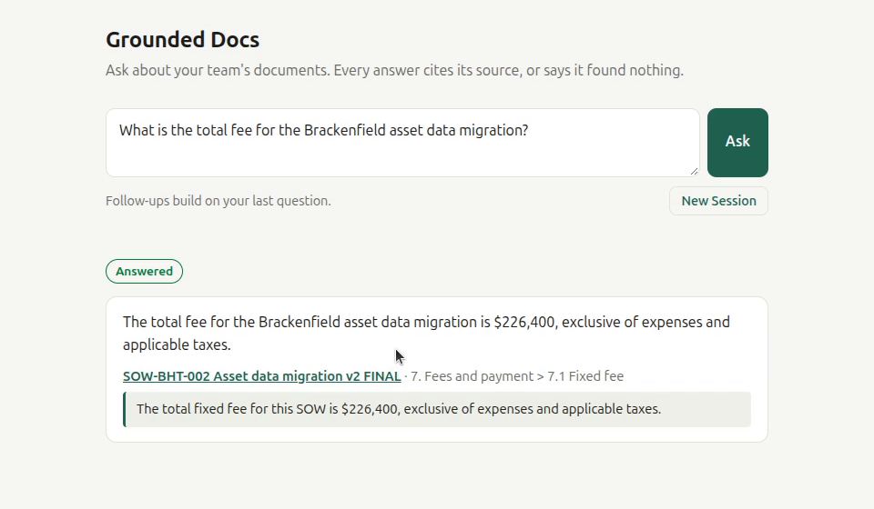
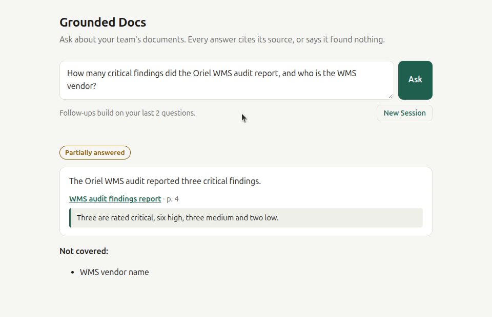
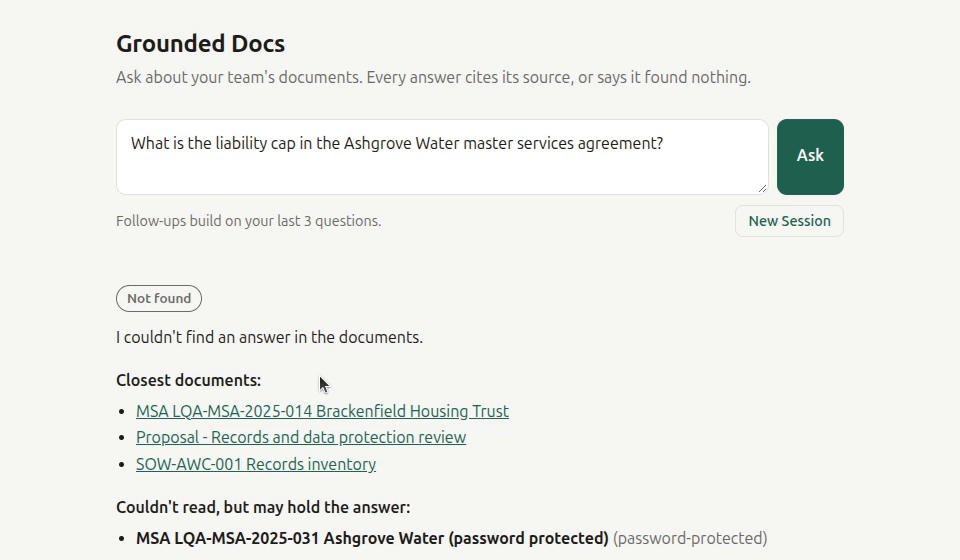
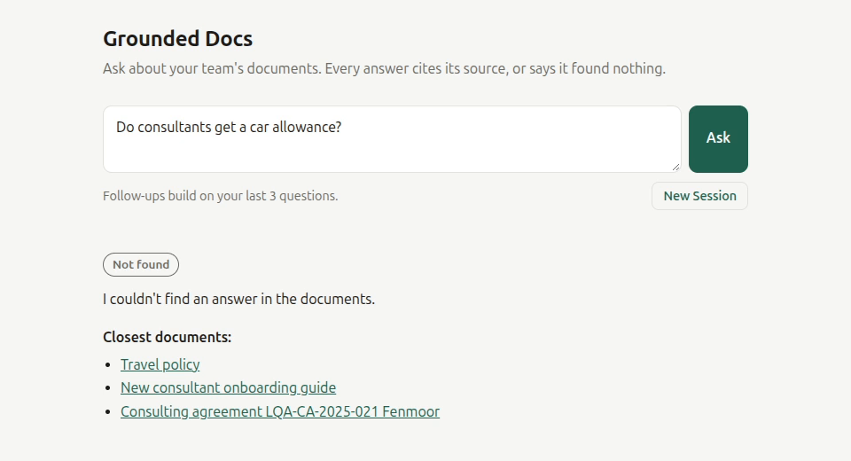
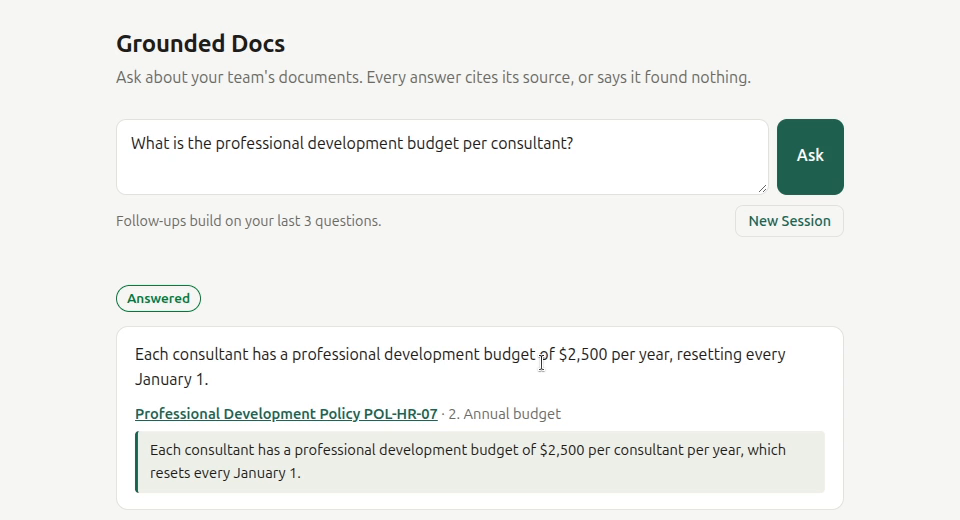
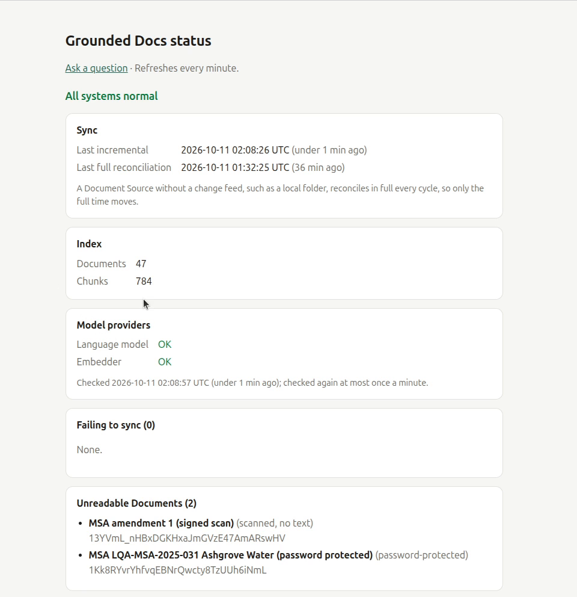
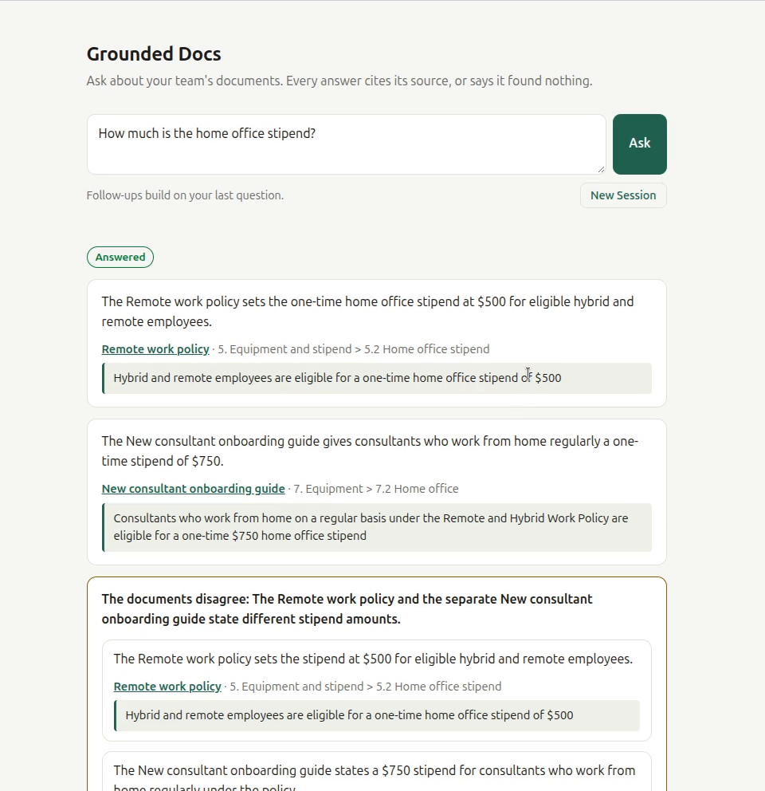
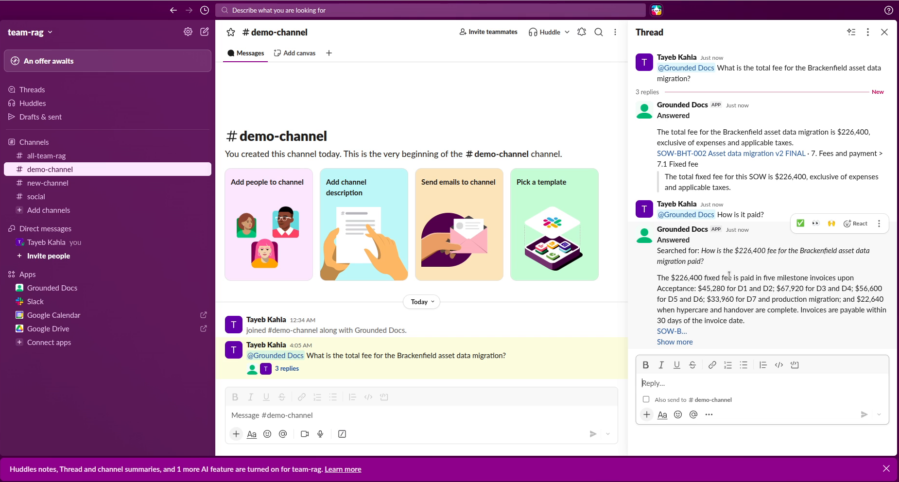
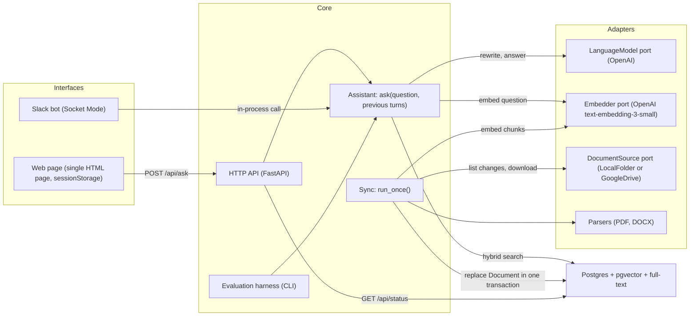
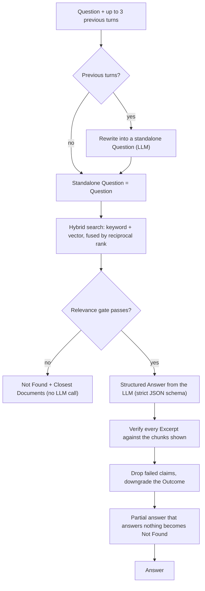

# Grounded Docs

[-0-brightgreen.svg)](#evaluation)

A private document assistant for small teams: ask in plain language, get answers drawn only from your own documents, every claim cited, or an honest "not found".

Point it at a Google Drive folder (or a local folder) of PDFs, Word files and Google Docs. Ask on a single web page or in Slack. Every claim in an Answer carries a verbatim Excerpt that the code has checked word for word against the source, and a link that opens the file. When the documents don't say, it says so instead of guessing.

> **About this repository.** This is the public showcase of Grounded Docs 1.0.0: what it does, how it is built, how it was measured, and samples of its code. The source code, tests and deployment files live in a private repository. See [Code access](#code-access).

## 🎥 Demo video

<!-- VIDEO: the user-attachments URL of grounded-docs-demo-readme.mp4, uploaded through this repository's issue box -->

Six and a half minutes, on a real Google Drive folder of about fifty documents: latest-version answers with checked Citations, Slack with a Follow-up, a Conflict, a Partial Answer, an unreadable file, a live edit and a deletion picked up by Sync, and a question the documents don't cover.

## What it does

- **Three honest Outcomes.** *Answered* (every claim cited), *Partially Answered* (the parts the documents don't cover are listed), or *Not Found* (with the closest documents to look in).
- **Grounding enforced in code, not in the prompt.** A relevance gate stops off-topic questions before any model call. The model answers in a strict JSON schema. Every Excerpt is checked word for word against the text the model was shown, and a claim that fails is dropped and the Outcome downgraded. A partial answer whose claims answer no part of the question becomes Not Found.
- **Conflicts and versions.** When two current documents disagree, the Answer shows both sides, each with its own citation. When documents are versions of one document (v3 and v4, DRAFT and FINAL), it answers from the latest.
- **Unreadable files are named, never silently skipped.** Password-protected PDFs, scans, oversized and unsupported files are listed on the status page. When one might hold the answer, the Answer says so.
- **Stays in step by itself.** Sync checks the folder every 2 minutes and runs a full reconciliation nightly. Added files become findable, edited ones are replaced atomically, and removed ones disappear.
- **Web page and Slack.** Mention the bot in a channel or send it a direct message; it answers in a thread with the same Citations. Follow-ups work in the thread.
- **Follow-ups without server-side history.** The Session lives in the browser tab or the Slack thread. The server stores no conversation.
- **Exact codes and IDs.** Searching for `LQA-MSA-2025-014` finds that contract, not its sibling `LQA-MSA-2025-031`. Hybrid search fuses keyword and vector ranking, and every code is indexed as one whole term.
- **Cheap to run.** $0.62 per 1,000 Questions on the measured held-out set, on one small server with Docker Compose.

## Screenshots

| | |
| --- | --- |
| **Answered, from the latest version.** The v1 DRAFT holds a different number; the Answer cites v2 FINAL, with the exact sentence.  | **Partially Answered.** What the documents cover is answered and cited; what they don't is listed.  |
| **Unreadable file named.** The contract that may hold the answer is password-protected, and the Answer says so.  | **Not Found, not invented.** A question the documents don't cover, with the closest documents to check.  |
| **Live edit.** The Google Doc was changed from $2,000 to $2,500; Sync picked it up on its own.  | **Status page.** Sync times, index size, provider health, and every file it couldn't read.  |

**A Conflict:** two current policies disagree, so both sides are shown, each cited.

**Slack:** the same Answer in a thread, and a Follow-up ("How is it paid?") understood from the thread.

## Architecture

One image runs four Docker Compose services: `api` (HTTP API, web page and status page), `sync` (the Sync loop), `slack` (the Slack bot) and `postgres`. A crash in `sync` or `slack` never takes down `api`.

Inside `Assistant.ask`:

Every external system (OpenAI, Google Drive, Slack, the file system) sits behind a port with a fake for tests, so the Assistant and Sync are tested end to end against a real Postgres without network calls. [ARCHITECTURE.md](ARCHITECTURE.md) covers the modules, Sync, storage and failure modes in depth, with the reasoning behind each choice. [CODE_SAMPLES.md](CODE_SAMPLES.md) shows the code that enforces grounding, and the tests that pin it down.

## Evaluation

Quality is measured, not claimed. The evaluation set is 99 questions over a demo corpus of 48 fictional PDF and DOCX files from a fictional consulting firm (policies, contracts, statements of work, rate cards, reports), seeded with near-duplicate versions, conflicts, exact codes, a password-protected PDF and a scanned one. 43 **dev** questions were used for every tuning decision, and 56 **held-out** questions were run only to report numbers. Each question has an expected Outcome, expected documents and key facts, and its category: answered, ID lookup, partial, two kinds of not found (a missing fact, an absent topic), conflict, follow-up, and sync (a scripted edit or removal, then a Sync, then the Question).

Every run is 3 repeats. Key facts are judged by an LLM with a fixed, versioned judge prompt, and about 10% of judgments are hand-checked. Latency is wall-clock through the real Assistant and OpenAI. Cost is from measured token usage at list prices, counted cold (no cache discount), hedged calls included.

### Held-out results (final run, default model)

`gpt-6-luna` (reasoning effort `none`), embeddings `text-embedding-3-small`, hedge after 5 s. 56 questions × 3 repeats, 2026-10-10. **All 8 targets met.**

| Metric | Target | Measured (mean, min to max) | Met |
| --- | --- | --- | --- |
| Invented answers on not_found questions | ≤ 1 (worst repeat) | **0** in every repeat | ✅ |
| Outcome accuracy | ≥ 85% | 94.0% (92.9% to 96.4%) | ✅ |
| Top-5 Document hit rate (Answered) | ≥ 90% | 92.0% | ✅ |
| Top-5 hit rate (ID lookups) | ≥ 90% | 100% | ✅ |
| Excerpt verification pass rate | ≥ 95% | 100% | ✅ |
| p95 latency | ≤ 8 s | 5.77 s (5.62 s to 5.93 s), 0 timeouts | ✅ |
| Cost per 1,000 Questions | ≤ $5 | **$0.62** cold ($0.60 to $0.62); $0.32 as billed with caching | ✅ |
| Freshness: added document answerable | ≤ 5 min | 121 s | ✅ |

Also measured: key-fact correctness 91.5% (88.4% to 93.0%), 1 wrong fact per repeat, Unreadable documents named 100% of the time, p50 latency 3.17 s.

Outcome confusion matrix, all 3 repeats (rows expected, columns given):

| Expected \ Given | Answered | Partially Answered | Not Found |
| --- | --- | --- | --- |
| Answered | 98 | 2 | 5 |
| Partially Answered | 3 | 18 | 0 |
| Not Found | 0 | 0 | 42 |

### Misses

Published whether or not targets are met. From the final held-out run:

- **"What's the maximum I can spend per night on a hotel in New York?"**: Not Found in 3 of 3 (the $260 cap sits in a table row; the relevance gate stopped it). A cautious miss, not an invented one.
- **(conflict) "How much notice do I need to give before taking three days off?"**: answered with one side only in 3 of 3; the two notice rules may be compatible, so the label is open to question.
- **"Does the firm have an office in London?"**: answered once, Not Found twice (the firm profile's office list is closed: Denver and Raleigh).
- **(partial) "How many asset records does Brackenfield have, and what will it cost to clean them up?"**: Answered instead of Partially Answered in 3 of 3; the record count was right, but the clean-up cost, which no document gives, was not listed as missing.
- Two questions with a wrong fact in some repeats, and two with one repeat Partially Answered instead of Answered.

### How it got there

The held-out split was run five times. Each run's misses were reproduced as new **dev** questions built from dev material, fixed on dev, and only then run on held-out again. The held-out set itself was never tuned on, but four rounds of its failure shapes did inform the fixes, so it is no longer an unseen set; further tuning needs a new held-out set.

| Target | 1st run | 2nd run | 3rd run | 4th run | **5th run** |
| --- | --- | --- | --- | --- | --- |
| Invented answers ≤ 1 | ❌ 4 | ❌ 2 | ❌ 2 | ❌ 2 | ✅ **0** |
| Outcome accuracy ≥ 85% | 85.7% | 91.1% | 89.9% | 89.3% | 94.0% |
| p95 ≤ 8 s | 7.96 s | 5.34 s | ❌ 9.84 s | 6.21 s | 5.77 s |
| Cost ≤ $5 / 1,000 | $0.383 | $0.577 | $0.579 | $0.741 | $0.615 |

What closed the gaps: claims that only say "the documents do not mention…" removed as unverifiable, keyword search over titles, 12 chunks instead of 8 so both sides of a conflict are shown; a hedged answer call against provider stalls (p95 back under 8 s); and a partial-answer check, which turned the last invented answers, partial answers made of neighbouring facts, into Not Found.

**Why this model:** the default is the cheapest model that meets every target. Answering goes through a `LanguageModel` port, so another provider (or a self-hosted model) is a single-adapter extension.

## Engineering

| | |
| --- | --- |
| **Stack** | Python 3.12, FastAPI, Pydantic, Postgres 17 with pgvector and full-text search, psycopg 3, Slack Bolt (Socket Mode), Docker Compose |
| **Design** | Two deep modules (`Assistant.ask`, `Sync.run_once`) behind small interfaces; every external system behind a port (`typing.Protocol`) with a fake |
| **Tests** | 777 tests: unit tests, adapter contract tests against recorded responses, and integration tests end to end against a real Postgres with pgvector |
| **Quality gates** | ruff lint and format, strict mypy, the full test suite, on every push and in a pre-commit hook |
| **CI** | Two jobs: the gates against a Postgres service, and a Docker Compose smoke test from a clean checkout with no provider keys. Every action pinned to a commit SHA |
| **Operations** | A status page, structured JSON logs (no Question or Answer text by default), non-root containers, services that pause with a reason instead of restart-looping, and an operator runbook (start, update, back up, re-index, rotate keys) |
| **Failure handling** | Timeouts and bounded retries with jitter on every provider call, a hedged answer call for tail latency, a 25 s overall budget, and never a fallback Answer: a failure is reported as a failure |

## Privacy

Documents leave the server only as chunks sent to OpenAI for embedding and answering, through the API (no training on API data by default; answering is sent with `store: false`). The index, the files and the Sync state stay in your own Postgres. The server keeps no conversation history, and by default logs no Question or Answer text. Real documents need a paid API tier whose terms exclude training on inputs.

## Roadmap

- **v1.1.0: Observability and feedback.** Answer events without Question or Answer text, runtime cost per Answer, 👍/👎 feedback, Grafana dashboards and alerts, spending limits, scheduled evaluation runs, a load test.
- **v1.2.0: Company sign-in and published images.** Google sign-in for the web page and status page, and versioned container images with an SBOM and provenance.
- **v1.3.0: More providers, measured.** Claude and Gemini adapters, a model comparison on a new held-out set, and a prompt-injection evaluation category.
- **v1.4.0: Multi-step questions.** An optional agentic mode for questions that need several lookups, with every Answer still verified.
- **v1.5.0: Automation.** API keys for the ask endpoint and a documented workflow automation example.
- **v2.0.0: Permission-aware retrieval.** Each person gets Answers only from the Documents they can open in Drive.

## Code access

The source code, tests, evaluation harness and deployment files are in a private repository. Read access is available on request to evaluate the work, and a walkthrough of the code on a call is just as welcome. To use Grounded Docs in your organization, ask for a commercial license, or for a deployment adapted to your documents and tools.

Contact: [github.com/TayebKahia](https://github.com/TayebKahia).

## License

© 2026 Tayeb Kahia. All rights reserved. See [LICENSE](LICENSE).
